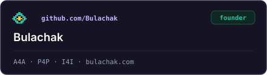
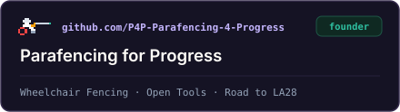
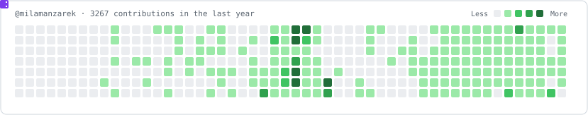

<picture>
  <source media="(prefers-color-scheme: dark)" srcset="./assets/hero-dark.svg">
  <source media="(prefers-color-scheme: light)" srcset="./assets/hero-light.svg">
  
</picture>

  
  
  
  
  
  

### Founded

<table>
  <tr>
    <td width="50%" valign="top">
      
      

        <strong><a href="https://github.com/Bulachak">@Bulachak</a></strong>&#160;·&#160;<a href="https://bulachak.com">bulachak.com&#160;↗</a> 
        Means&#160;"the&#160;future" in&#160;Tatar. Founded to&#160;build client-owned AI&#160;tools and&#160;operational systems across sport&#160;(<code>A4A</code>), adaptive fencing&#160;(<code>P4P</code>), and&#160;immigrant communities&#160;(<code>I4I</code>), with&#160;4% of&#160;gross revenue pledged to&#160;adaptive sport and&#160;kinship.
      

    </td>
    <td width="50%" valign="top">
      
      

        <strong><a href="https://github.com/P4P-Parafencing-4-Progress">@P4P-Parafencing-4-Progress</a></strong>&#160;·&#160;<a href="https://bulachak.com/p4p">bulachak.com/p4p&#160;↗</a> 
        Founded to&#160;expand access to&#160;wheelchair and&#160;adaptive fencing through equipment pathways, open coaching tools, and&#160;athlete support heading into&#160;LA28.
      

    </td>
  </tr>
</table>

──)───────────

### What's on my desk

  
  
  
  
  
  
  
  
  
  
  
  
  
   
  
  
  
  
  
  
  
  
  
  
  
  
  

<picture>
  <source media="(prefers-color-scheme: dark)" srcset="./assets/contrib-snake-dark.svg">
  <source media="(prefers-color-scheme: light)" srcset="./assets/contrib-snake-light.svg">
  
</picture>
